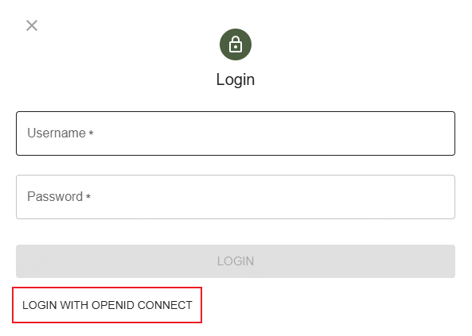

# Configuration

## OpenID Connect options

These settings go under `auth.openid` in your Verdaccio config (`config.yaml`):

| Config key               | Type                                                                  | Default                                                                                     | Required | Description                                                                                                                                                                                                                                         |
| ------------------------ | --------------------------------------------------------------------- | ------------------------------------------------------------------------------------------- | -------- | --------------------------------------------------------------------------------------------------------------------------------------------------------------------------------------------------------------------------------------------------- |
| `provider-host`          | `string`                                                              |                                                                                             | Yes      | The host of the OIDC provider.                                                                                                                                                                                                                      |
| `configuration-uri`      | `string`                                                              |                                                                                             | No       | The URI of the OIDC provider configuration.                                                                                                                                                                                                         |
| `issuer`                 | `string`                                                              |                                                                                             | No       | The issuer of the OIDC provider. Used when manually configuring individual endpoints; defaults to `provider-host` if not set.                                                                                                                       |
| `authorization-endpoint` | `string`                                                              |                                                                                             | No       | The authorization endpoint.                                                                                                                                                                                                                         |
| `token-endpoint`         | `string`                                                              |                                                                                             | No       | The token endpoint.                                                                                                                                                                                                                                 |
| `userinfo-endpoint`      | `string`                                                              |                                                                                             | No       | The userinfo endpoint.                                                                                                                                                                                                                              |
| `jwks-uri`               | `string`                                                              |                                                                                             | No       | The JWKS URI.                                                                                                                                                                                                                                       |
| `scope`                  | `string`                                                              | `openid`                                                                                    | No       | The OIDC scope.                                                                                                                                                                                                                                     |
| `client-id`              | `string`                                                              |                                                                                             | Yes      | The client ID from the OIDC provider.                                                                                                                                                                                                               |
| `client-secret`          | `string`                                                              |                                                                                             | Yes      | The client secret from the OIDC provider.                                                                                                                                                                                                           |
| `username-claim`         | `string`                                                              | `sub`                                                                                       | No       | The claim used to get the username from the ID token or userinfo endpoint.                                                                                                                                                                          |
| `groups-claim`           | `string`                                                              |                                                                                             | No       | The claim used to get the groups from the ID token or userinfo endpoint.                                                                                                                                                                            |
| `provider-type`          | `string`                                                              |                                                                                             | No       | The provider type for fetching groups. Supported: `gitlab`.                                                                                                                                                                                         |
| `store-type`             | `"in-memory"` \| `"redis"` \| `"file"` \| `"dynamodb"` \| `"mongodb"` | `in-memory`                                                                                 | No       | The store backend for OIDC state and caches. See [Store Configuration](store-config.md).                                                                                                                                                            |
| `store-config`           | `string` \| `object`                                                  | — (unset; backend defaults: state expires after 60s, user info and group cache after 5 min) | No       | Store-specific configuration. `file` requires `dir` and `dynamodb` requires `tableName` + `region` here; `mongodb` may take `uri` from `VERDACCIO_OPENID_STORE_CONFIG_URI` instead. See [Store Configuration](store-config.md).                     |
| `keep-passwd-login`      | `boolean`                                                             | auto-detect                                                                                 | No       | Keep the htpasswd login dialog. See [keep-passwd-login](#keep-passwd-login).                                                                                                                                                                        |
| `login-button-text`      | `string`                                                              | `Login with OpenID Connect`                                                                 | No       | The text of the OpenID login button.                                                                                                                                                                                                                |
| `authorized-groups`      | `string` \| `string[]` \| `boolean`                                   | `false`                                                                                     | No       | Groups allowed to log in. `true` requires at least one group; `false` disables group check.                                                                                                                                                         |
| `group-users`            | `object`                                                              |                                                                                             | No       | Custom group-to-user mapping. When set, groups from `group-users` override any groups obtained from `groups-claim` or `provider-type`. Leave `provider-type` and `groups-claim` unset when using only `group-users` to avoid unnecessary API calls. |

### Provider discovery

The plugin discovers the OIDC provider configuration in one of three ways:

1. **Via `configuration-uri`** — directly fetch the provider metadata from the given URI. When set, issuer verification is skipped. See [OpenID Client Discovery](https://github.com/panva/openid-client/blob/main/docs/functions/discovery.md).
2. **Via individual endpoints** — set `authorization-endpoint`, `token-endpoint`, `userinfo-endpoint`, and `jwks-uri` manually. When any of these are set, auto-discovery is skipped.
3. **Via `provider-host`** — auto-discover from the provider's `.well-known/openid-configuration` endpoint.

Discovery failures back off: the retry waits 5 seconds and doubles up to 60 seconds. A login that arrives during the cooldown fails immediately with `OpenID configuration discovery is cooling down after a recent failure` instead of hitting the provider again.

### `provider-type: gitlab`

When set to `gitlab`, the plugin uses the [GitLab Groups API](https://docs.gitlab.com/ee/api/groups.html) to fetch the user's groups instead of reading them from the ID token or userinfo claims. The user's access token is used to authenticate against the GitLab API.

Requirements:

- `provider-host` must point to the GitLab instance (e.g. `https://gitlab.com`).
- The `groups-claim` config is ignored — groups always come from the API.
- Groups are matched by their **full path** (`team/backend`, or `backend` for a top-level group), which is unique.
  A group name is not: anyone allowed to create a group could name it like a group they are not in,
  so configure `authorized-groups` and `group-users` keys with full paths.

## `keep-passwd-login`

By default, the plugin checks whether `auth.htpasswd.file` is set in your Verdaccio config. If it is, the htpasswd login dialog is kept alongside the OIDC login button.

Explicitly set `keep-passwd-login` to override this behavior:

```yaml
auth:
  openid:
    keep-passwd-login: true # Force keep
    # keep-passwd-login: false  # Force hide
```

With both authentication methods enabled, users can choose between htpasswd and OIDC login on the login page.



## Token expiration

For JWT tokens, expiration is controlled by Verdaccio's security settings, not by this plugin. AES legacy tokens expire with the provider token instead, see [Token verification](#token-verification):

```yaml
security:
  api:
    jwt:
      sign:
        expiresIn: 7d # npm CLI token expiration
  web:
    sign:
      expiresIn: 7d # web UI token expiration
```

See the [Verdaccio docs](https://verdaccio.org/docs/configuration#security) for details.

## Token verification

The plugin has two token modes, and which one is used is decided by Verdaccio's `security` settings, not by the plugin.

### JWT tokens (recommended)

When `security.api.jwt` is set, Verdaccio verifies npm tokens itself, and the plugin never accepts a token as a password. A legacy `npm login` that puts a token in the password field is rejected, so a token cannot be used to obtain another one and removing a user at the provider takes effect when the token expires.

The same goes for `npm login --auth-type=legacy` and for any other client that sends `_auth: base64(user:token)`: use `_authToken` instead. npm, pnpm and yarn 1 all support it:

```ini
# before
_auth=YWxpY2U6ZXlKaGJHY2lPaUpJVXpJMU5pSjkuLi4=
# after
//registry.example.com/:_authToken=eyJhbGciOiJIUzI1NiJ9...
```

### AES legacy tokens (not recommended)

When `security.api.legacy: true` is set and `security.api.jwt` is not (Verdaccio's default security configuration), Verdaccio encrypts npm tokens instead of signing them. Such a token expires together with the provider token it was issued for, not according to `security.api.jwt.sign.expiresIn`, and it stays tied to the account it was issued to. Tokens issued by earlier versions of the plugin are rejected, so those users have to log in once more.

## Client script caching

The page loads one client script named after its content hash, served with a one-year `immutable` cache policy, while the page itself is always revalidated. A published package only contains the resources of its own build and never carries old scripts. Before serving new HTML, put the old and new scripts together on the shared origin. Keep them until every replica and cached page has moved over and the rollback window has closed; then clear the old scripts.
