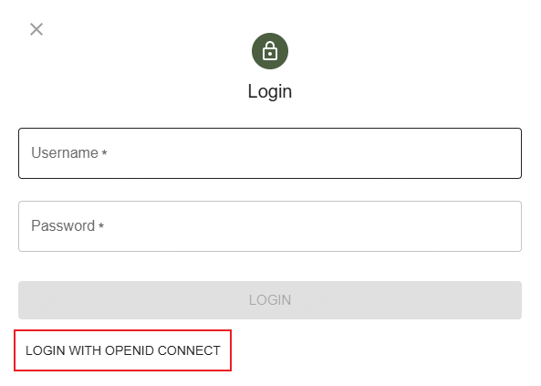

# 配置

## OpenID Connect 选项

以下选项配置在 Verdaccio 配置文件（`config.yaml`）的 `auth.openid` 下：

| 配置项                   | 类型                                                                  | 默认值                      | 必填 | 说明                                                                                                                                                                                               |
| ------------------------ | --------------------------------------------------------------------- | --------------------------- | ---- | -------------------------------------------------------------------------------------------------------------------------------------------------------------------------------------------------- |
| `provider-host`          | `string`                                                              |                             | 是   | OIDC 提供方的主机地址。                                                                                                                                                                            |
| `configuration-uri`      | `string`                                                              |                             | 否   | OIDC 提供方配置的 URI。                                                                                                                                                                            |
| `issuer`                 | `string`                                                              |                             | 否   | OIDC 提供方的 issuer。手动配置端点时使用，默认值为 `provider-host`。                                                                                                                               |
| `authorization-endpoint` | `string`                                                              |                             | 否   | 授权端点。                                                                                                                                                                                         |
| `token-endpoint`         | `string`                                                              |                             | 否   | Token 端点。                                                                                                                                                                                       |
| `userinfo-endpoint`      | `string`                                                              |                             | 否   | 用户信息端点。                                                                                                                                                                                     |
| `jwks-uri`               | `string`                                                              |                             | 否   | JWKS URI。                                                                                                                                                                                         |
| `scope`                  | `string`                                                              | `openid`                    | 否   | OIDC 作用域。                                                                                                                                                                                      |
| `client-id`              | `string`                                                              |                             | 是   | OIDC 提供方的客户端 ID。                                                                                                                                                                           |
| `client-secret`          | `string`                                                              |                             | 是   | OIDC 提供方的客户端密钥。                                                                                                                                                                          |
| `username-claim`         | `string`                                                              | `sub`                       | 否   | 从 ID token 或 userinfo 端点获取用户名的 claim。                                                                                                                                                   |
| `groups-claim`           | `string`                                                              |                             | 否   | 从 ID token 或 userinfo 端点获取用户组的 claim。                                                                                                                                                   |
| `provider-type`          | `string`                                                              |                             | 否   | 获取用户组的提供方类型。支持：`gitlab`。                                                                                                                                                           |
| `store-type`             | `"in-memory"` \| `"redis"` \| `"file"` \| `"dynamodb"` \| `"mongodb"` | `in-memory`                 | 否   | OIDC 状态和缓存的存储后端。详见 [存储配置](store-config.md)。                                                                                                                                      |
| `store-config`           | `string` \| `object`                                                  | `{ ttl: 60000 }`            | 否   | 存储后端配置。详见 [存储配置](store-config.md)。                                                                                                                                                   |
| `keep-passwd-login`      | `boolean`                                                             | 自动检测                    | 否   | 保留 htpasswd 登录对话框。详见 [keep-passwd-login](#keep-passwd-login)。                                                                                                                           |
| `login-button-text`      | `string`                                                              | `Login with OpenID Connect` | 否   | OpenID 登录按钮的文本。                                                                                                                                                                            |
| `authorized-groups`      | `string` \| `string[]` \| `boolean`                                   | `false`                     | 否   | 允许登录的用户组。`true` 要求至少属于一个组；`false` 不检查组。                                                                                                                                    |
| `group-users`            | `object`                                                              |                             | 否   | 自定义组-用户映射。设置后，`group-users` 中的组会覆盖从 `groups-claim` 或 `provider-type` 获取的组。如果仅使用 `group-users`，请勿设置 `provider-type` 和 `groups-claim` 以避免不必要的 API 调用。 |

### 提供方发现

插件通过以下三种方式之一发现 OIDC 提供方配置：

1. **通过 `configuration-uri`** — 直接从给定 URI 获取提供方元数据。设置后将跳过 issuer 验证。详见 [OpenID Client Discovery](https://github.com/panva/openid-client/blob/main/docs/functions/discovery.md)。
2. **通过独立端点** — 手动设置 `authorization-endpoint`、`token-endpoint`、`userinfo-endpoint` 和 `jwks-uri`。设置任一后，自动发现将被跳过。
3. **通过 `provider-host`** — 从提供方的 `.well-known/openid-configuration` 端点自动发现。

### `provider-type: gitlab`

设置为 `gitlab` 时，插件使用 [GitLab Groups API](https://docs.gitlab.com/ee/api/groups.html) 获取用户组，而不是从 ID token 或 userinfo claims 中读取。用户的 access token 用于向 GitLab API 认证。

要求：

- `provider-host` 必须指向 GitLab 实例（例如 `https://gitlab.com`）。
- `groups-claim` 配置将被忽略 — 组始终来自 API。

## `keep-passwd-login`

默认情况下，插件会检查 Verdaccio 配置中是否设置了 `auth.htpasswd.file`。如果设置了，htpasswd 登录对话框会与 OIDC 登录按钮一同显示。

显式设置 `keep-passwd-login` 可覆盖此行为：

```yaml
auth:
  openid:
    keep-passwd-login: true # 强制保留
    # keep-passwd-login: false  # 强制隐藏
```

两种认证方式同时启用时，用户可在登录页面上选择 htpasswd 或 OIDC 登录。



## Token 过期时间

对于 JWT token，过期时间由 Verdaccio 的安全设置控制，而非本插件；AES legacy token 则随 provider token 过期，见 [Token 校验](#token-校验)：

```yaml
security:
  api:
    jwt:
      sign:
        expiresIn: 7d # npm CLI token 过期时间
  web:
    sign:
      expiresIn: 7d # web UI token 过期时间
```

详见 [Verdaccio 文档](https://verdaccio.org/docs/configuration#security)。

## Token 校验

插件有两种 token 模式，具体用哪一种由 Verdaccio 的 `security` 配置决定，而不是插件。

### JWT token（推荐）

配置了 `security.api.jwt` 时，npm token 由 Verdaccio 自己校验，插件不会把 token 当作密码接受。在 legacy `npm login` 中把 token 填进密码栏会被拒绝，因此 token 不能用来换取新 token，在提供方移除用户后会在 token 过期时生效。

`npm login --auth-type=legacy` 这类把 token 填进密码栏的方式同样不再可用；其他仍在发送 `_auth: base64(user:token)` 的客户端需要改用 `_authToken`。npm、pnpm、yarn 1 都支持：

```ini
# 之前
_auth=YWxpY2U6ZXlKaGJHY2lPaUpJVXpJMU5pSjkuLi4=
# 之后
//registry.example.com/:_authToken=eyJhbGciOiJIUzI1NiJ9...
```

### AES legacy token（不推荐）

在设置 `security.api.legacy: true` 且没有 `security.api.jwt` 时（这是 Verdaccio 的默认安全配置），Verdaccio 加密而不是签名 npm token。这类 token 的过期时间与签发时使用的 provider token 一致，不遵循 `security.api.jwt.sign.expiresIn`，并且与签发时的账号绑定。旧版本插件签发的 token 会被拒绝，用户需要重新登录一次。
